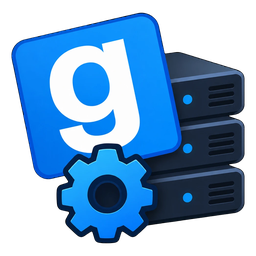
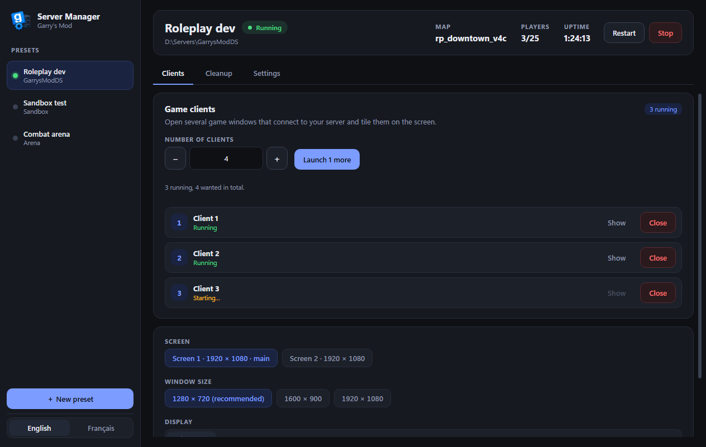
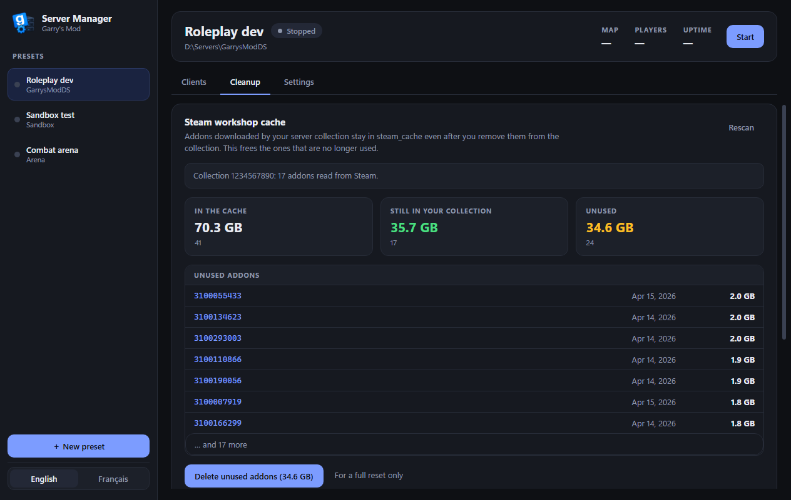
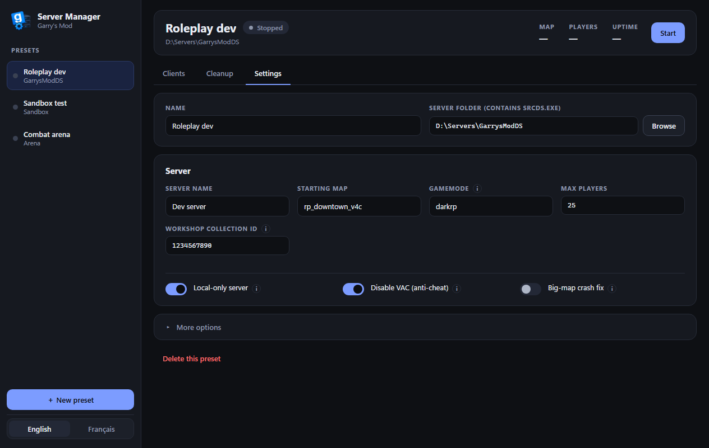

<p align="center"></p>
<h1 align="center">Server Manager</h1>

**Run your local Garry's Mod dev server without the headache.** Start it, test it with a few clients, clean it up.



- 🟢 Knows when your server is **really online** (the `VAC secure mode is activated` line, or the map being loaded)
- 🪟 **Test clients** in one click: pick the screen and size, they tile themselves and are numbered, **Show** flashes the number on the right window, close them one by one
- 🎛️ Plain on/off switches for `sv_lan`, `-insecure` and `r_hunkalloclightmaps`, with a tooltip that says what each does
- 🧹 **Clean `steam_cache`**: removes workshop addons your collection no longer uses, nothing else
- 🗑️ Wipe `data/` and `sv.db` with a checklist and a zip backup
- 💾 One preset per server, English and French

## Get it

Download the zip from [Releases](../../releases), extract it, run `Server Manager.exe`. Windows x64.

## Use it

1. **Settings**: pick your server folder (the one with `srcds.exe`), set name, map, gamemode, max players and your workshop collection ID
2. **Start**: the server opens in its own console window, the app shows **Running** once it is online
3. **Clients**: choose how many game windows and what size, hit **Launch**
4. **Cleanup**: stop the server, scan, delete what is unused

The game client (`gmod.exe`) is found automatically. If not, pick it in **Clients → More options**.

## Good to know

- **Built for a local dev server.** The only thing it fetches online is your collection's addon list from Steam.
- The app adds `-console -condebug` to your launch arguments and reads `garrysmod/console.log` to detect when the server is up.
- The cleaner is careful. It refuses to run while the server is up, when the collection can't be read, or if it would delete everything. It backs up `appworkshop_4000.acf` first and checks the result after.
- Only addons **missing from your collection** are removed. The ones in it are never touched.

<details>
<summary>More screenshots</summary>

 

Screenshots use demo data.

</details>

## Build it yourself

```bash
npm install --legacy-peer-deps
npm run dev          # run it
npm run package      # Windows build in release/
```

Electron, TypeScript and React. Needs Node 20 or newer.

## License

[AGPL-3.0](LICENSE) © 2026 sogekiDEV
